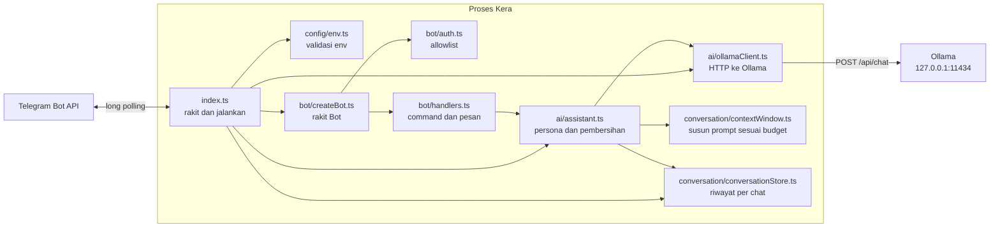

# 02 - Application Architecture

Dokumen ini menjelaskan struktur kode yang sudah ada. Bagian yang belum dibangun
ditandai "rencana".

## Komponen



| Modul | Tanggung jawab | Tidak boleh |
| --- | --- | --- |
| `src/index.ts` | Membaca config, merakit client + store -> assistant -> bot, cek Ollama, long polling, shutdown | Berisi logika balasan |
| `src/config/env.ts` | Satu-satunya tempat yang membaca `process.env`; menghasilkan `Config` bertipe | Mengetahui Telegram atau Ollama |
| `src/bot/createBot.ts` | Urutan middleware, error boundary | Memanggil `bot.start()` |
| `src/bot/auth.ts` | Memutuskan siapa boleh memakai bot | Membalas pesan |
| `src/bot/handlers.ts` | Menerjemahkan update Telegram ke panggilan assistant dan kembali; pesan error untuk user | Membuat request HTTP ke Ollama |
| `src/bot/replyChunks.ts` | Memecah teks panjang sesuai batas Telegram | |
| `src/bot/typing.ts` | Status "typing..." selama menunggu | |
| `src/ai/assistant.ts` | Persona Kera (system prompt), alur satu jawaban (riwayat -> prompt -> model -> simpan), membersihkan output model | Mengetahui Telegram |
| `src/ai/ollamaClient.ts` | HTTP ke Ollama: request, timeout, `num_ctx`, validasi respon, klasifikasi error | Mengetahui persona, riwayat, atau Telegram |
| `src/conversation/contextWindow.ts` | Perkiraan token dan memilih giliran riwayat yang muat di budget (fungsi murni) | Menyimpan state atau memanggil jaringan |
| `src/conversation/conversationStore.ts` | Menyimpan giliran per `chat.id`, batas 20 giliran | Mengetahui token atau model |
| `src/errors.ts` | `describeError`: ringkasan error yang aman untuk log | |

## Kenapa dipisah seperti ini

- Config terpusat: error konfigurasi muncul saat startup, bukan di tengah percakapan.
- Membuat bot dipisah dari menjalankan bot: test bisa menyuntikkan update palsu, dan
  webhook bisa ditambahkan nanti tanpa mengubah handler (ADR-0001).
- Auth sebagai middleware pertama: tidak ada handler yang "lupa" dicek.
- Bot tidak tahu Ollama, Ollama client tidak tahu Telegram. Handler hanya memanggil
  `assistant.reply(chatId, text)`. Kalau suatu saat model diganti ke API lain, yang
  berubah hanya `src/ai/`.
- `assistant` dipisah dari `ollamaClient`: client mengurus "bagaimana berbicara HTTP
  dengan Ollama", assistant mengurus "apa yang dikatakan Kera" dan kapan riwayat disimpan.
- `src/conversation/` dipisah dari `src/ai/`: aturan memotong riwayat (`contextWindow.ts`)
  adalah fungsi murni yang bisa diuji dengan data saja, dan cara menyimpan riwayat
  (`ConversationStore`) bisa diganti SQLite di Milestone 4 tanpa mengubah assistant.
- Dependency dioper sebagai parameter (`BotDependencies`, `fetch` di `OllamaClientOptions`),
  bukan diimpor global. Ini dependency injection versi paling sederhana: test bisa
  memberi versi palsu tanpa library mocking.

## Alur konfigurasi

```
.env -> (node --env-file-if-exists) -> process.env -> loadConfig() -> Config
  Config.telegramBotToken, allowedUserIds -> createBot()
  Config.ollama                          -> createOllamaClient()
  Config.ollama.numCtx - MAX_REPLY_TOKENS -> promptTokenBudget -> createAssistant()
```

## Alur error

| Sumber error | Ditangani di | Hasil |
| --- | --- | --- |
| Env tidak valid | `loadConfigOrExit()` di `index.ts` | Daftar masalah dicetak, exit code 1 |
| Ollama mati / model belum ada saat startup | `warnIfModelUnavailable()` di `index.ts` | Warning di log, bot tetap jalan |
| Token ditolak (401) atau ada instance lain (409) | `main().catch` di `index.ts` | `Kera failed: ...`, exit code 1 |
| Ollama gagal saat menjawab pesan | `createTextHandler()` di `handlers.ts` | Pesan ramah ke user sesuai `OllamaError.kind`, detail di log |
| Telegram gagal saat mengirim balasan | Error boundary di `createBot()` | Di-log, update berikutnya tetap diproses |
| Gagal mengirim status typing | `withTypingIndicator()` | Diabaikan (best effort) |

Semua pesan log dibentuk oleh `describeError()` yang hanya mengambil field aman,
sehingga token dan isi pesan user tidak ikut tercetak.

## Yang sengaja dibuat sederhana

- Logging memakai `console`.
- Riwayat percakapan di memori proses (`Map`), hilang saat restart (sampai Milestone 4).
- Update diproses berurutan (bawaan `bot.start()`). GPU juga hanya bisa mengerjakan satu
  jawaban pada satu waktu, jadi paralelisme tidak mempercepat apa pun untuk satu pengguna.
  Urutan ini juga menjamin dua jawaban tidak menulis riwayat chat yang sama bersamaan.
- Tidak ada retry ke Ollama. Gagal sekali langsung dilaporkan ke user.
- Belum ada folder `services/` dan `db/`.

## Kapan arsitektur ini perlu diubah

- Ada lebih dari satu pengguna aktif: satu jawaban lambat menahan pengguna lain.
  Pertimbangkan `@grammyjs/runner` dengan antrean per chat.
- Logika bisnis tumbuh (notes, reminder): pindahkan ke `services/` supaya handler hanya
  menerjemahkan Telegram ke pemanggilan service.
