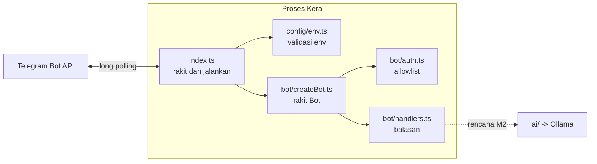

# 02 - Application Architecture

Dokumen ini menjelaskan struktur kode yang sudah ada. Bagian yang belum dibangun
ditandai "rencana".

## Komponen



| Modul | Tanggung jawab | Tidak boleh |
| --- | --- | --- |
| `src/index.ts` | Membaca config, membuat bot, memilih cara menjalankan (long polling), shutdown | Berisi logika balasan |
| `src/config/env.ts` | Satu-satunya tempat yang membaca `process.env`; mengubahnya jadi `Config` bertipe | Mengetahui Telegram |
| `src/bot/createBot.ts` | Menyusun urutan middleware, error boundary, format error yang aman di-log | Memanggil `bot.start()` |
| `src/bot/auth.ts` | Memutuskan siapa boleh memakai bot | Membalas pesan |
| `src/bot/handlers.ts` | Isi balasan untuk tiap jenis pesan | Mengecek izin (sudah dijamin auth) |
| `src/bot/logger.ts` | Tipe `Logger` yang bisa diganti di test | |

## Kenapa dipisah seperti ini

- Config terpusat: kalau nama variabel berubah atau ada variabel baru, hanya satu file
  yang diubah, dan error konfigurasi muncul saat startup, bukan di tengah percakapan.
- Membuat bot dipisah dari menjalankan bot: `createBot()` tidak tahu apakah update
  datang dari long polling, webhook, atau test. Karena itu test bisa menyuntikkan
  update palsu, dan webhook bisa ditambahkan nanti tanpa mengubah handler (ADR-0001).
- Auth sebagai middleware pertama: handler tidak perlu mengecek izin satu per satu,
  sehingga tidak ada handler baru yang "lupa" dicek.
- Dependency dioper sebagai parameter (`config`, `logger`), bukan diimpor global.
  Ini disebut dependency injection versi paling sederhana: test bisa memberi logger
  palsu tanpa library mocking.

## Alur konfigurasi

```
.env -> (node --env-file-if-exists) -> process.env -> loadConfig() -> Config -> createBot(config)
```

Hanya `loadConfig()` yang membaca `process.env`. Modul lain menerima `Config`.

## Alur error

| Sumber error | Ditangani di | Hasil |
| --- | --- | --- |
| Env tidak valid | `loadConfigOrExit()` di `index.ts` | Daftar masalah dicetak, exit code 1 |
| Token ditolak (401) atau ada instance lain (409) | `main().catch` di `index.ts` | `Kera failed: ...`, exit code 1 |
| Error di middleware/handler saat memproses update | Error boundary di `createBot()` | Di-log, update berikutnya tetap diproses |
| Error yang lolos boundary (seharusnya tidak ada) | `bot.catch()` | Di-log, polling tidak berhenti |

Semua pesan error dibentuk oleh `describeError()` yang hanya mengambil field aman,
sehingga token dan isi pesan user tidak ikut tercetak.

## Yang sengaja dibuat sederhana

- Logging memakai `console`. Belum ada level log yang bisa dikonfigurasi atau file log.
- Belum ada folder `ai/`, `services/`, `db/`; dibuat saat milestone yang membutuhkan.
- Update diproses berurutan (bawaan `bot.start()` grammY). Cukup untuk satu pengguna.

## Kapan arsitektur ini perlu diubah

- Balasan butuh waktu lama (model AI) dan beberapa chat aktif bersamaan -> pertimbangkan
  pemrosesan paralel per chat (`@grammyjs/runner`). Dievaluasi di Milestone 2-3.
- Logika bisnis mulai tumbuh (notes, reminder) -> pindahkan ke `services/` supaya
  handler hanya menerjemahkan Telegram ke pemanggilan service.
