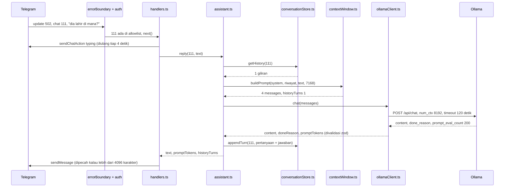

# 03 - Request and Data Flow

## Startup

```
npm run dev
  -> node --watch --env-file-if-exists=.env src/index.ts
  -> main()
       1. loadConfigOrExit()                 src/index.ts
            loadConfig(process.env)          src/config/env.ts
              gagal -> cetak masalah, exit 1
       2. allowlist kosong? -> console.warn
       3. createOllamaClient(config.ollama)  src/ai/ollamaClient.ts
       4. warnIfModelUnavailable()           POST /api/show, timeout 5 detik
            berhasil -> "Ollama is ready ... (context 8192 tokens)"
            gagal    -> console.warn, lanjut
       5. createAssistant({ client, store, promptTokenBudget })
            store  = createInMemoryConversationStore()   kosong setiap start
            budget = 8192 - 1024 = 7168 token
            log "Prompt token budget for assistant: 7168 tokens"
            log "Max reply tokens for assistant: 1024 tokens"
       6. createBot({ token, allowedUserIds, assistant, logger })
            errorBoundary -> auth -> /start -> /ping -> /reset -> message:text -> message
       7. stopOnSignals(bot.stop)            SIGINT/SIGTERM
       8. await bot.start()
            deleteWebhook dan getMe          token salah -> reject -> "Kera failed", exit 1
            onStart -> "Kera is running as @..."
            loop getUpdates                  (long polling)
```

## Konsep: long polling

Bot memanggil `getUpdates` ke Telegram. Kalau belum ada pesan, Telegram menahan
request itu (sampai sekitar 30 detik) lalu menjawab kosong; bot langsung bertanya lagi.
Kalau ada pesan, Telegram langsung menjawab dengan daftar update.

Setiap update punya `update_id`. Pada request berikutnya bot mengirim
`offset = update_id terakhir + 1`, artinya "update sebelum ini sudah diproses".
grammY mengurus offset ini secara otomatis. Hanya satu proses boleh polling dengan
token yang sama; proses kedua mendapat 409 Conflict.

Update yang masuk saat bot mati disimpan Telegram (sampai 24 jam) dan diproses saat bot
hidup lagi, satu per satu.

## Satu pesan teks dari pemilik

Contoh: pemilik (ID `111`) sebelumnya bertanya `siapa presiden pertama indonesia?` dan
dijawab `Soekarno.`. Sekarang ia mengirim `dia lahir di mana?`.



Jejak yang sama dengan data konkret:

```
Telegram -> getUpdates response
  { update_id: 502, message: { from: { id: 111 }, chat: { id: 111 }, text: "dia lahir di mana?" } }

grammY menjalankan middleware berurutan:

  errorBoundary(logUpdateError)                 createBot.ts
    -> authMiddleware: 111 ada di allowlist -> await next()
    -> command("start"), ("ping"), ("reset")    bukan command -> lewati
    -> on("message:text") -> createTextHandler  handlers.ts
         withTypingIndicator                    typing.ts
           sendChatAction { action: "typing" }  segera, lalu tiap 4 detik
           assistant.reply(111, "dia lahir di mana?")           assistant.ts
             store.getHistory(111)                               conversationStore.ts
               -> [ { user: "siapa presiden pertama indonesia?", assistant: "Soekarno." } ]
             buildPrompt({ ..., budget: 7168 })                  contextWindow.ts
               tetap: system (551 karakter) 229 + pesan baru 16 = 245 perkiraan token
               giliran terakhir: 22 + 12 = 34 -> 279 <= 7168 -> ambil
               (perkiraan per pesan = ceil(karakter / 2.5) + 8)
               messages = [ system, user: "siapa presiden...", assistant: "Soekarno.",
                            user: "dia lahir di mana?" ]
             ollamaClient.chat(messages)                         ollamaClient.ts
               POST http://127.0.0.1:11434/api/chat
                 { model: "qwen3:4b-instruct", messages, stream: false, think: false,
                   options: { num_predict: 1024, num_ctx: 8192 } }
               signal: AbortSignal.timeout(120000)
               <- 200 { message: { content: "Soekarno lahir di Surabaya." },
                        done_reason: "stop", prompt_eval_count: 200, ... }
               validasi zod -> { content, doneReason: "stop", promptTokens: 200 }
             cleanModelOutput -> "Soekarno lahir di Surabaya."
             store.appendTurn(111, { user: "dia lahir di mana?", assistant: "Soekarno lahir di Surabaya." })
             -> { text, promptTokens: 200, historyTurns: 1 }
           clearInterval (di finally)
         splitMessage -> 1 bagian
         sendMessage { chat_id: 111, text: "Soekarno lahir di Surabaya." }
         log: "Replied to update 502 in 775 ms (1 message(s), prompt 200 tokens, history 1 turn(s))"
```

Riwayat hanya berisi giliran yang berhasil. Kalau `ollamaClient.chat` melempar error,
`appendTurn` tidak dijalankan dan riwayat tetap seperti sebelumnya.

## Riwayat lebih panjang dari budget

```
riwayat chat 111: 20 giliran, total perkiraan 9000 token
buildPrompt: mulai dari giliran ke-20 (terbaru) mundur
  ... ke-8: total 7100 <= 7168 -> ambil
  ke-7: total 7400 >  7168 -> berhenti, giliran 1-7 tidak dikirim
messages = [ system, giliran 8-20, pesan baru ]   (giliran 1-7 tetap ada di store)
```

Giliran yang tidak dikirim tidak dihapus dari store. Store sendiri hanya menyimpan 20
giliran terakhir; giliran ke-21 membuang giliran pertama. Berapa giliran yang biasanya
muat, dan kapan riwayat hilang: `docs/notes/conversation-memory.md`.

## /reset

```
update { chat: { id: 111 }, text: "/reset" }
  -> auth -> command("reset") -> createResetHandler     handlers.ts
       assistant.resetConversation(111) -> store.clear(111)
       sendMessage "Oke, obrolan kita mulai dari awal. ..."
  model tidak dipanggil, riwayat chat lain tidak tersentuh
```

Telegram dan Ollama berbeda sifat:

| | Telegram Bot API | Ollama API |
| --- | --- | --- |
| Lokasi | Internet, `api.telegram.org` | Laptop sendiri, `127.0.0.1:11434` |
| Arah | Kera bertanya terus (polling), juga mengirim balasan | Kera memanggil, Ollama menjawab |
| Autentikasi | Token di URL | Tidak ada; aman hanya karena listen di localhost |
| Waktu respon | Milidetik | 0.2 detik sampai puluhan detik, tergantung panjang jawaban |
| Format error | `{ ok: false, error_code, description }` | `{ error: "..." }` + status HTTP |

## Jawaban panjang

```
assistant.reply -> teks 9000 karakter
splitMessage -> potong di baris baru / spasi terakhir sebelum 4096
  -> 3 bagian -> 3x sendMessage berurutan
```

Kalau model berhenti karena `num_predict` habis, Ollama mengirim `done_reason: "length"`
dan assistant menambahkan catatan "(Jawaban terpotong ...)".

## Ollama gagal

```
ollamaClient.chat
  fetch melempar TypeError "fetch failed"      -> OllamaError("unreachable")
  fetch melempar TimeoutError (120 detik)      -> OllamaError("timeout")
  status 404                                   -> OllamaError("model_not_found")
  status lain non-2xx                          -> OllamaError("http_error")
  body bukan JSON / bentuk tidak sesuai schema -> OllamaError("invalid_response")

createTextHandler menangkap error:
  logger.error("Assistant failed for update 501: Ollama error (unreachable): ...")
  ctx.reply(userMessageForError(error))  -> "Aku nggak bisa menghubungi Ollama. ..."
  update selesai normal
```

## Pesan dari orang asing

```
update { from: { id: 999 }, text: "halo" }
  -> authMiddleware: 999 tidak di allowlist
       logger.warn("Ignored update ... id=999 ...")
       return tanpa next() -> tidak ada handler, assistant tidak dipanggil, tidak ada balasan
```

## Telegram gagal saat mengirim balasan

```
ctx.reply gagal (jaringan putus, Telegram 400/403)
  -> error naik dari handler -> next() di auth -> errorBoundary
  -> logUpdateError: logger.error("Error while handling update 501: ...")
  -> polling lanjut ke update berikutnya; balasan itu tidak dicoba ulang
```

## Shutdown

```
Ctrl+C -> SIGINT -> stopOnSignals -> bot.stop()
  -> grammY menunggu update yang sedang diproses selesai (termasuk yang sedang menunggu Ollama)
  -> mengirim offset terakhir ke Telegram
  -> bot.start() selesai -> "Kera stopped." -> exit code 0
```
