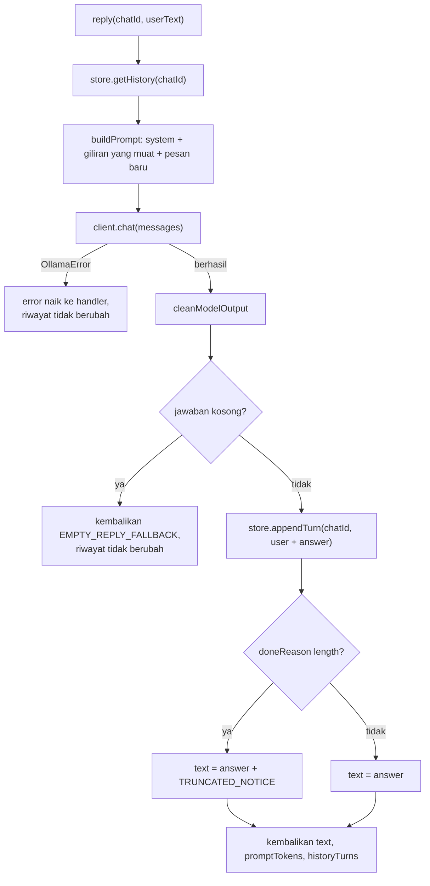

# Milestone 3 - Bounded Conversation Context

## 1. Tujuan

Kera mengingat beberapa giliran terakhir percakapan di setiap chat, sehingga pertanyaan
lanjutan seperti "dia lahir di mana?" dimengerti. Riwayat terpisah per chat, dibatasi
supaya selalu muat di context window model, dan bisa dihapus dengan `/reset`.

## 2. Prasyarat

- Milestone 2 selesai: pesan teks dijawab oleh `qwen3:4b-instruct`.
- Ollama berjalan dan model sudah di-pull.

## 3. Konsep yang dipelajari

- Model bahasa bersifat stateless: "ingatan" adalah riwayat yang dikirim ulang di setiap request.
- Context window (`num_ctx`): batas token untuk input dan output sekaligus.
- Token vs karakter, dan memperkirakan token tanpa tokenizer.
- Budget: membagi context window untuk prompt dan jawaban.
- Memotong riwayat dari yang paling lama, per pasangan pertanyaan + jawaban.
- State di memori proses (`Map`) dan isolasi per key (`chat.id`).
- Interface sebagai batas modul: `ConversationStore` bisa diganti implementasi lain.
- Fungsi murni (pure function): `buildPrompt` tidak menyentuh jaringan atau state, jadi
  bisa diuji dengan data saja.
- Prefix cache Ollama.

## 4. Kenapa milestone ini perlu

Tanpa riwayat, setiap pesan berdiri sendiri dan percakapan alami ("terus?", "yang tadi")
tidak bisa dipakai. Riwayat juga dasar untuk Milestone 4 (riwayat permanen di SQLite) dan
Milestone 7 (tool calling butuh beberapa putaran pesan dalam satu percakapan).

## 5. Urutan pengerjaan

1. Ukur dulu, karena semua angka batas bergantung pada hasilnya (ADR-0004): rasio
   karakter per token, VRAM per `num_ctx`, dan perilaku Ollama saat prompt terlalu panjang.
2. `OLLAMA_NUM_CTX` di `src/config/env.ts` + test.
3. `ollamaClient` mengirim `num_ctx` dan membaca `prompt_eval_count` + test.
4. `src/conversation/contextWindow.ts` (fungsi murni) + test.
5. `src/conversation/conversationStore.ts` + test.
6. `assistant` memakai store dan `buildPrompt`; `reply` menerima `chatId` + test.
7. `/reset`, teks `/start`, log token, `createBot`, `index.ts` + test.
8. Test integrasi ke Ollama asli, percakapan nyata lewat assistant, mutation check, cek startup.
9. Dokumentasi.
10. Uji manual lewat Telegram (bagian 18).

## 6. File

| File | Status |
| --- | --- |
| `src/conversation/contextWindow.ts`, `.test.ts` | Baru |
| `src/conversation/conversationStore.ts`, `.test.ts` | Baru |
| `src/ai/assistant.ts`, `.test.ts` | Diubah: options object, `reply(chatId, text)`, `resetConversation`, `AssistantReply`, system prompt |
| `src/ai/ollamaClient.ts`, `.test.ts`, `.integration.test.ts` | Diubah: kirim `num_ctx`, baca `prompt_eval_count`, test perilaku overflow |
| `src/bot/handlers.ts` | Diubah: `createResetHandler`, teks `/start`, log token dan giliran |
| `src/bot/createBot.ts`, `.test.ts` | Diubah: command `/reset` |
| `src/config/env.ts`, `.test.ts` | Diubah: `OLLAMA_NUM_CTX` |
| `src/index.ts` | Diubah: merakit store dan budget, log ukuran context saat startup |
| `.env.example` | Diubah |
| `docs/decisions/ADR-0004-context-window-and-history-budget.md` | Baru |

## 7. Tanggung jawab file

Lihat tabel komponen di `02-application-architecture.md`.

## 8. Penjelasan fungsi penting

### `buildPrompt(input)` - `src/conversation/contextWindow.ts`

Input: system prompt, riwayat (`Turn[]` dari lama ke baru), pesan baru, dan budget token.
Output: `messages` untuk `/api/chat` dan jumlah giliran yang ikut.

Contoh dengan angka dari test (`contextWindow.test.ts`): system `"s"` dan pesan `"u"`
masing-masing `ceil(1 / 2.5) + 8 = 9` token, jadi 18 token tetap. Setiap giliran berisi
dua teks 25 karakter: `2 x (ceil(25 / 2.5) + 8) = 36` token. Dengan budget
`18 + 2 x 36 = 90` dan riwayat `[t1, t2, t3]`:

```
mulai: used = 18
t3: 18 + 36 = 54  <= 90 -> ambil
t2: 54 + 36 = 90  <= 90 -> ambil
t1: 90 + 36 = 126 >  90 -> berhenti
hasil: [system, t2.user, t2.assistant, t3.user, t3.assistant, user]
```

Diagram alur loop ini, beserta perkiraan berapa giliran yang muat untuk berbagai
panjang pesan, ada di `docs/notes/conversation-memory.md`.

Loop berhenti (`break`) di giliran pertama yang tidak muat, walaupun giliran yang lebih
lama mungkin kecil dan masih muat. Kalau giliran di tengah dilompati, model membaca
percakapan yang bolong dan bisa salah paham ("dia" merujuk ke orang yang sudah hilang).

### `estimateMessageTokens(content)`

`ceil(content.length / 2.5) + 8`. Angka 2.5 dan 8 berasal dari pengukuran (ADR-0004),
dibulatkan ke arah aman. Perkiraan sengaja berlebih: di percakapan nyata (bagian 17),
perkiraan sekitar 1.4x angka asli dari Ollama.

### `createInMemoryConversationStore(maxTurns)` - `src/conversation/conversationStore.ts`

`Map<number, Turn[]>` di dalam closure. `appendTurn` menambah di akhir lalu membuang dari
depan kalau melebihi `maxTurns` (20). `getHistory` mengembalikan salinan array, jadi kode
lain tidak bisa mengubah isi store tanpa lewat method.

Method-nya `async` walaupun `Map` tidak butuh menunggu. Tujuannya supaya interface
`ConversationStore` tetap sama saat diganti database di Milestone 4.

Riwayat disimpan sebagai `Turn { user, assistant }`, bukan daftar pesan bebas. Dengan
bentuk ini, tidak mungkin ada pertanyaan tanpa jawaban di riwayat, dan pemotongan selalu
membuang pasangan utuh.

### `assistant.reply(chatId, userText)` - `src/ai/assistant.ts`



Giliran disimpan setelah model berhasil menjawab. Kalau `client.chat` melempar error,
`appendTurn` tidak pernah dijalankan. Jawaban yang disimpan tidak memuat
`TRUNCATED_NOTICE`, karena catatan itu untuk user, bukan bagian dari jawaban model.

`createAssistant` sekarang menerima satu objek options (`{ client, store, promptTokenBudget }`),
bukan parameter berurutan, supaya pemanggil menulis nama setiap dependency dan urutannya
tidak bisa tertukar.

### `createResetHandler(assistant)` - `src/bot/handlers.ts`

Memanggil `assistant.resetConversation(ctx.chat.id)` lalu membalas konfirmasi. Tidak
memanggil model.

## 9. Alur data dan kontrol

Lihat `03-request-and-data-flow.md`: pesan dengan riwayat, `/reset`, dan riwayat yang
melebihi budget.

## 10. Tipe dan dependency

| Nama | Dari | Arti |
| --- | --- | --- |
| `Turn` | `conversationStore.ts` | `{ user, assistant }`, satu giliran |
| `ConversationStore` | `conversationStore.ts` | `{ getHistory, appendTurn, clear }`, semua async |
| `BuiltPrompt` | `contextWindow.ts` | `{ messages, historyTurns }` |
| `AssistantReply` | `assistant.ts` | `{ text, promptTokens, historyTurns }` |
| `Assistant` | `assistant.ts` | `{ reply(chatId, userText), resetConversation(chatId) }` |
| `AssistantOptions` | `assistant.ts` | `{ client, store, promptTokenBudget }` |
| `ChatResult` | `ollamaClient.ts` | Bertambah `promptTokens` |
| `OllamaConfig` | `env.ts` | Bertambah `numCtx` |

Tidak ada dependency npm baru.

## 11. Keputusan dan alternatif

Keputusan yang disetujui sebelum implementasi:

- Riwayat di memori lewat interface `ConversationStore`, bukan langsung SQLite dan bukan
  parameter `context` Ollama (hanya ada di `/api/generate`, deprecated, tidak bisa dibaca).
- Key riwayat `chat.id`, bukan `from.id`.
- Batas berupa budget token (diperkirakan dari karakter) ditambah batas 20 giliran.
- `num_ctx` 8192 lewat `OLLAMA_NUM_CTX`: ADR-0004.
- Giliran disimpan setelah jawaban berhasil, sebagai satu pasangan.
- Hanya `/reset`, tanpa kedaluwarsa otomatis.

Penyimpangan dari rencana:

- Batas bawah `OLLAMA_NUM_CTX` awalnya 2048. Test integrasi menunjukkan dugaan awal salah:
  Ollama tidak selalu memotong diam-diam. Percakapan panjang memang dipotong diam-diam,
  tetapi satu pesan yang sendirian melebihi `num_ctx` ditolak dengan HTTP 400. Batas bawah
  dinaikkan ke 4096 supaya pesan Telegram terpanjang selalu muat, dan test integrasi
  dipecah menjadi dua perilaku itu.

## 12. Trade-off dan keterbatasan

- Riwayat hilang saat Kera restart (sampai Milestone 4).
- Perkiraan token berlebih, jadi ruang riwayat yang terpakai lebih kecil dari budget.
- Tidak ada ringkasan: giliran lama dibuang utuh, bukan diringkas.
- Setiap kali giliran lama dibuang, prefix cache Ollama tidak terpakai dan seluruh prompt
  diproses ulang (sekitar 1500 token per detik).
- Model kecil tetap bisa salah fakta. Di uji nyata, model menyebut Soekarno lahir di
  Madiun (yang benar Surabaya). Riwayat membuat model konsisten dengan jawabannya sendiri,
  termasuk yang salah.
- Pesan yang gagal dijawab tidak tersimpan. "Tadi aku nanya apa?" setelah Ollama mati
  tidak akan tahu pertanyaan yang gagal.
- Di grup, semua anggota berbagi satu riwayat (key `chat.id`). Kera saat ini tidak
  ditujukan untuk grup.
- Update diproses berurutan oleh `bot.start()`, jadi dua jawaban tidak pernah menulis ke
  riwayat chat yang sama bersamaan. Kalau pemrosesan dibuat paralel (misalnya dengan
  `@grammyjs/runner`), asumsi ini harus ditinjau.

## 13. Konfigurasi

| Variabel | Default | Keterangan |
| --- | --- | --- |
| `OLLAMA_NUM_CTX` | `8192` | 4096 sampai 131072. Budget prompt = nilai ini - 1024 |

Konstanta di kode (bukan env, karena jarang perlu diubah dan berkaitan dengan pengukuran):

| Konstanta | Nilai | File |
| --- | --- | --- |
| `MAX_STORED_TURNS` | 20 | `conversationStore.ts` |
| `CHARS_PER_TOKEN_ESTIMATE` | 2.5 | `contextWindow.ts` |
| `MESSAGE_OVERHEAD_TOKENS` | 8 | `contextWindow.ts` |
| `MAX_REPLY_TOKENS` | 1024 | `assistant.ts` |

## 14. Error handling dan edge case

| Kasus | Perilaku | Terverifikasi |
| --- | --- | --- |
| Ollama gagal saat menjawab | Pesan error ke user, riwayat tidak berubah | Test unit |
| Model menjawab kosong | Fallback ke user, giliran tidak disimpan | Test unit |
| Jawaban terpotong `num_predict` | Disimpan tanpa catatan terpotong | Test unit |
| Riwayat melebihi budget | Giliran paling lama dibuang, tidak ada celah | Test unit |
| Pesan baru sendiri melebihi budget | Dikirim tanpa riwayat | Test unit |
| Satu pesan melebihi `num_ctx` | Ollama: HTTP 400 -> `http_error` | Test integrasi Ollama asli |
| Percakapan melebihi `num_ctx` (tanpa pemotongan dari Kera) | Ollama membuang pesan lama diam-diam | Test integrasi Ollama asli |
| Lebih dari 20 giliran | Giliran paling lama dibuang dari store | Test unit |
| Dua chat berbeda | Riwayat tidak tercampur | Test unit |
| `/reset` | Riwayat chat itu saja yang dihapus | Test unit + integrasi bot |
| `OLLAMA_NUM_CTX=2048` | Exit 1, `OLLAMA_NUM_CTX: must be at least 4096` | Ya |

## 15. Keamanan

- Riwayat hanya di memori proses, tidak ditulis ke disk dan tidak di-log. Log hanya
  memuat jumlah token dan jumlah giliran.
- Riwayat dipisah per `chat.id`. Orang yang tidak ada di allowlist tidak pernah sampai ke
  assistant, jadi tidak punya riwayat dan tidak bisa membaca riwayat orang lain.
- Prompt injection kini bisa bertahan lintas pesan: instruksi di satu pesan ikut terkirim
  di pesan-pesan berikutnya. Dampaknya masih kecil karena model belum punya aksi
  (Milestone 7). `/reset` membersihkannya.
- Store dibatasi 20 giliran per chat, dan pesan Telegram maksimal 4096 karakter, jadi
  memori per chat terbatas (kira-kira 20 x (4096 + 4096 karakter jawaban) di kasus terburuk).

## 16. Perintah

| Perintah | Tujuan |
| --- | --- |
| `npm test` | Test unit dan integrasi bot |
| `npm run test:ollama` | Test ke Ollama asli, termasuk perilaku overflow |
| `curl http://127.0.0.1:11434/api/ps` | `context_length` dan `size_vram` model yang sedang dimuat |
| `nvidia-smi` | Pemakaian VRAM total |

Mengukur token sendiri (Git Bash), lihat field `prompt_eval_count`:

```
curl -s http://127.0.0.1:11434/api/chat -d '{"model":"qwen3:4b-instruct","stream":false,"options":{"num_predict":1},"messages":[{"role":"user","content":"Kemarin aku pergi ke pasar bersama ibu."}]}'
```

## 17. Test dan hasil aktual

`npm test`: 11 file, 107 test, semua lulus. `npm run typecheck`: lulus.
`npm run test:ollama`: 6 test, semua lulus.

| File | Jenis | Yang diuji |
| --- | --- | --- |
| `contextWindow.test.ts` | Unit | Perkiraan token, budget, tanpa riwayat, urutan, buang yang paling lama, batas tepat dan kurang 1, tidak melompati giliran besar, pesan baru melebihi budget |
| `conversationStore.test.ts` | Unit | Chat kosong, urutan, isolasi antar chat, batas `maxTurns`, `clear` per chat, salinan, `maxTurns` tidak valid |
| `assistant.test.ts` | Unit, client palsu | Riwayat ikut di request berikutnya, isolasi chat, pemotongan budget, catatan terpotong tidak disimpan, kosong tidak disimpan, error tidak mengubah riwayat, reset |
| `createBot.test.ts` | Integrasi bot | `/reset` memanggil reset untuk chat itu tanpa model, `chat.id` sampai ke assistant, format log baru |
| `env.test.ts` | Unit | Default, kosong, kustom, dan nilai tidak valid `OLLAMA_NUM_CTX` |
| `ollamaClient.test.ts` | Unit | `num_ctx` dikirim, `promptTokens` dibaca, field opsional tidak ada |
| `ollamaClient.integration.test.ts` | Ollama asli | `promptTokens` terisi, percakapan panjang dipotong diam-diam, satu pesan terlalu panjang -> 400 |

Mutation check (kode dirusak sementara, test harus gagal):

| Perubahan | Test gagal |
| --- | --- |
| `break` diganti `continue` di `buildPrompt` | 1 |
| Cek budget dihapus | 4 |
| Store mengembalikan array internal | 1 |
| Batas `maxTurns` dihapus | 1 |
| `appendTurn` tidak dipanggil | 2 |
| Catatan terpotong ikut disimpan | 2 |
| `num_ctx` tidak dikirim | 1 |
| Command `/reset` salah nama | 1 |

Satu celah yang diketahui: test tidak bisa membedakan `ctx.chat.id` dari `ctx.from.id`,
karena di private chat Telegram keduanya sama.

Percakapan nyata lewat assistant + store + Ollama asli (skrip sementara, sudah dihapus):

| Pesan | Riwayat | Token asli | Perkiraan | Waktu |
| --- | --- | --- | --- | --- |
| siapa presiden pertama indonesia? | 0 | 177 | 251 | 449 ms |
| dia lahir di mana? | 1 | 200 | 281 | 775 ms |
| jelaskan singkat perannya dalam proklamasi | 2 | 254 | 346 | 2030 ms |
| (`/reset`) dia siapa tadi? | 0 | 175 | 243 | 1624 ms |

Pesan kedua dan ketiga dimengerti merujuk ke Soekarno. Setelah reset, model tidak tahu
"dia" siapa.

Startup dengan token palsu: `Ollama is ready with model qwen3:4b-instruct at
http://127.0.0.1:11434 (context 8192 tokens)`, lalu 401. Setelah itu `index.ts` juga
mencetak `Prompt token budget for assistant: 7168 tokens` dan
`Max reply tokens for assistant: 1024 tokens`.

## 18. Verifikasi manual

1. `npm run dev`. Harapan: `Ollama is ready ... (context 8192 tokens)`.
2. Kirim `/start`. Harapan: teks menyebut Kera ingat obrolan dan ada `/reset`.
3. Kirim `siapa presiden pertama indonesia?`, lalu `dia lahir di mana?`. Harapan: jawaban
   kedua tentang orang yang sama. Log: `history 1 turn(s)`.
4. Kirim `/reset`, lalu `dia siapa tadi?`. Harapan: Kera tidak tahu. Log: `history 0 turn(s)`.
5. Kirim beberapa pesan, Ctrl+C, `npm run dev` lagi, lalu tanya yang tadi. Harapan: lupa.
6. `curl http://127.0.0.1:11434/api/ps`. Harapan: `context_length` 8192, `size_vram`
   sekitar 3.9 GB.
7. Set `OLLAMA_NUM_CTX=2048`, jalankan. Harapan: exit dengan pesan `must be at least 4096`.
   Kembalikan nilainya.
8. Kirim lebih dari 20 pertanyaan dalam satu obrolan. Harapan: angka `history` di log
   berhenti naik paling tinggi di 20, dan `prompt` tetap jauh di bawah 8192.

Hasil langkah 1 sampai 8 lewat Telegram belum terverifikasi saat dokumen ini ditulis.

## 19. Troubleshooting

| Gejala | Penyebab dan solusi |
| --- | --- |
| Kera lupa setelah restart | Normal sampai Milestone 4: riwayat hanya di memori |
| Kera terus membahas topik lama | Kirim `/reset` |
| Jawaban pertama setelah ganti `OLLAMA_NUM_CTX` lambat | Model di-load ulang dengan ukuran context baru |
| `size_vram` lebih kecil dari `size` di `/api/ps` | Sebagian model di CPU. Turunkan `OLLAMA_NUM_CTX` |
| Log `prompt ? tokens` | Ollama tidak mengirim `prompt_eval_count`. Jawaban tetap jalan |
| Model mengulang jawaban salah dari sebelumnya | Riwayat membuat model konsisten dengan dirinya sendiri. `/reset` lalu tanya ulang |

## 20. Latihan

1. Ubah `CHARS_PER_TOKEN_ESTIMATE` menjadi 4. Tebak test mana yang gagal dan kenapa, lalu
   jalankan `npm test`. Kenapa 4 berbahaya untuk teks bahasa Indonesia?
2. Hitung dengan tangan: dengan `OLLAMA_NUM_CTX=4096`, berapa budget prompt? Kalau system
   prompt 551 karakter, berapa token tersisa untuk riwayat menurut perkiraan Kera?
3. Ganti `break` dengan `continue` di `buildPrompt`. Test mana yang gagal? Buat contoh
   percakapan di mana riwayat yang bolong membuat model salah paham.
4. Tambahkan command `/history` yang membalas jumlah giliran tersimpan (tanpa isi pesan),
   lengkap dengan test di `createBot.test.ts`. Interface mana yang harus berubah?
5. Matikan Ollama, kirim satu pertanyaan, nyalakan lagi, lalu tanya "tadi aku nanya apa?".
   Jelaskan hasilnya dengan menunjuk baris di `assistant.ts`.

## 21. Gap dan milestone berikutnya

- Riwayat hilang saat restart.
- Belum ada data pribadi yang tersimpan (catatan, tugas).

Milestone 4 menambahkan SQLite: skema dan migrasi, implementasi `ConversationStore` yang
menyimpan riwayat ke database, dan dasar penyimpanan untuk notes, tasks, dan reminder.
