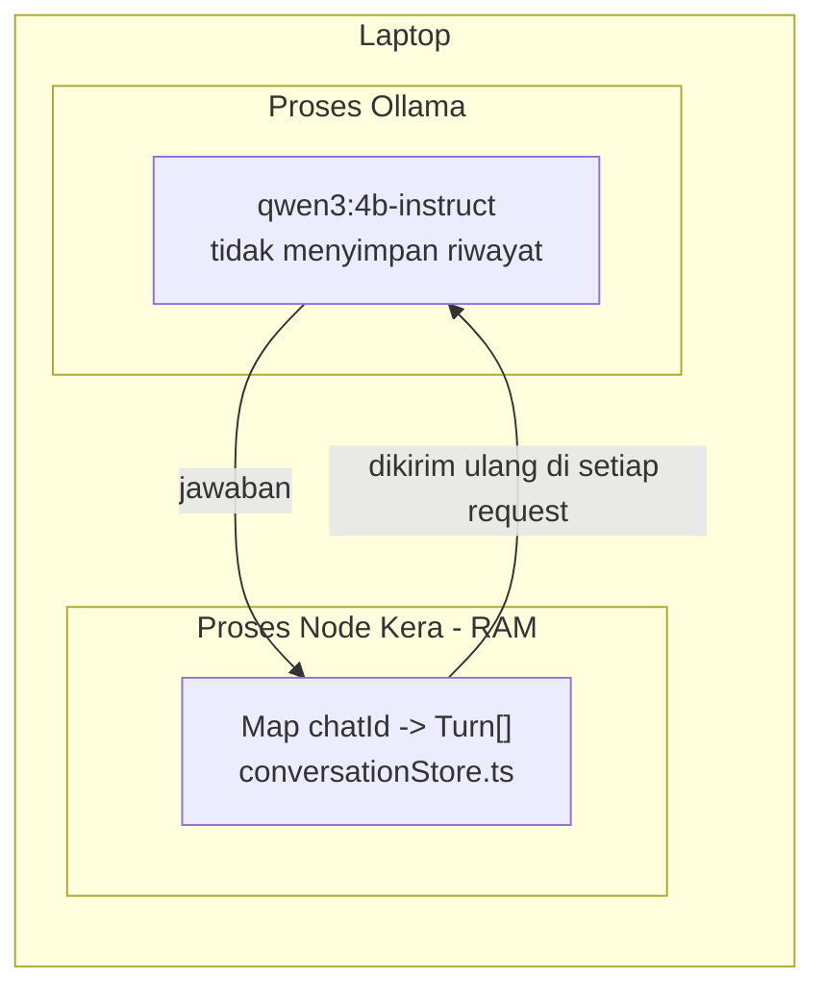
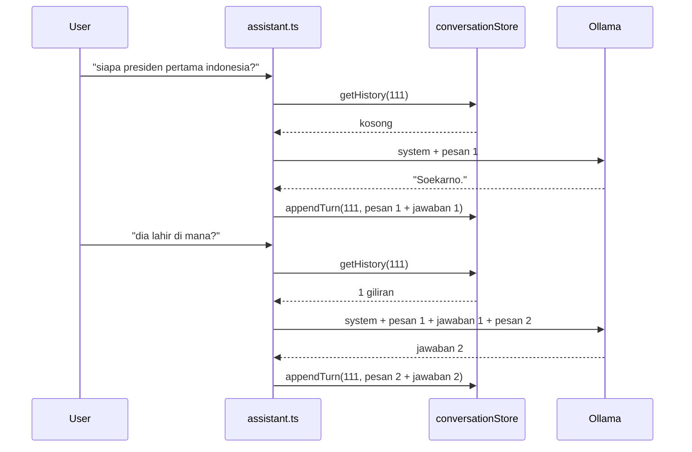
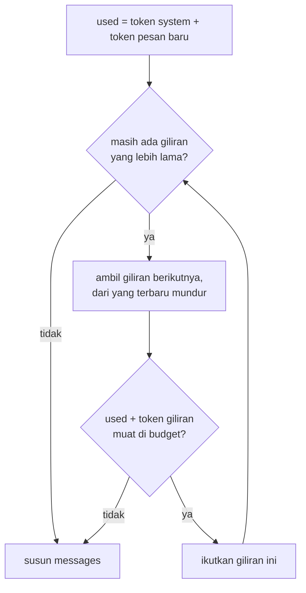

# Conversation memory

Catatan tentang cara Kera "mengingat" percakapan, di mana ingatan itu disimpan, dan
batasnya. Detail kode per fungsi ada di `docs/learning/milestones/milestone-03.md`
bagian 8; keputusan angka-angkanya di ADR-0004.

## Model tidak menyimpan apa pun

`qwen3:4b-instruct` tidak punya ingatan antar request. Setiap `POST /api/chat` diproses
dari nol: model hanya tahu isi field `messages` di request itu. "Ingatan" sepenuhnya
dibuat oleh Kera, dengan cara mengirim ulang percakapan sebelumnya di setiap request.

Bukti, dua request langsung ke Ollama (diuji 2026-10-20):

```
messages: [ user: "Nama kucingku Bento.",
            assistant: "Oke, Bento lucu namanya.",
            user: "Siapa nama kucingku?" ]
-> "Nama kucingmu adalah Bento. ..."            prompt_eval_count 42

messages: [ user: "Siapa nama kucingku?" ]
-> "Wah, aku tidak tahu nama kucingmu ya ..."  prompt_eval_count 15
```

Pesan `assistant` di request pertama tidak pernah diucapkan model; isinya ditulis
manual. Model tetap "ingat", karena yang ia baca hanya array `messages`. Artinya
riwayat bisa direkayasa oleh siapa pun yang menyusun request, dan model tidak bisa
membedakan riwayat asli dari palsu.

Coba sendiri (Git Bash):

```
curl -s http://127.0.0.1:11434/api/chat -d '{"model":"qwen3:4b-instruct","stream":false,"messages":[{"role":"user","content":"Nama kucingku Bento."},{"role":"assistant","content":"Oke."},{"role":"user","content":"Siapa nama kucingku?"}]}'
```

## Di mana riwayat disimpan



- Tempatnya: sebuah `Map` JavaScript di dalam proses Node Kera
  (`src/conversation/conversationStore.ts:37`). Tidak ada file, database, atau cache di disk.
- Key: `chat.id` Telegram. Value: array `Turn { user, assistant }`, dari lama ke baru.
- Yang ditulis: pesan user dan jawaban model yang sudah dibersihkan, setelah model
  berhasil menjawab (`src/ai/assistant.ts:87`).
- Ollama memang menyimpan cache hitungan untuk awal prompt yang sama (prefix cache),
  tapi itu hanya optimasi kecepatan. Kalau Kera tidak mengirim riwayat, model tetap tidak tahu.

## Alur dua pesan berturut-turut



Model mengerti "dia" karena pesan 1 dan jawaban 1 ikut terkirim di request kedua.
Jumlah token prompt naik setiap giliran; terlihat di log
`Replied ... (prompt 177 tokens, history 0 turn(s))` lalu `(prompt 200 tokens, history 1 turn(s))`.

## Seberapa jauh riwayat diingat

Ada dua batas. Yang lebih ketat yang berlaku.

1. Store menyimpan paling banyak 20 giliran per chat (`MAX_STORED_TURNS`). Giliran ke-21
   membuang giliran paling lama dari `Map`.
2. Saat request disusun, `buildPrompt` hanya mengambil giliran terbaru yang muat di
   budget 7168 token (`OLLAMA_NUM_CTX` 8192 - 1024 untuk jawaban). Giliran yang tidak
   muat tetap ada di store, hanya tidak dikirim.

Perkiraan berapa giliran yang benar-benar dibaca model, dengan system prompt 551 karakter
dan rumus perkiraan `ceil(karakter / 2.5) + 8` per pesan:

| Panjang pertanyaan | Panjang jawaban | Perkiraan token per giliran | Muat di budget | Yang dikirim |
| --- | --- | --- | --- | --- |
| 40 karakter | 300 karakter | 152 | 45 | 20 (batas store) |
| 40 karakter | 800 karakter | 352 | 19 | 19 |
| 100 karakter | 1500 karakter | 656 | 10 | 10 |
| 200 karakter | 3000 karakter | 1296 | 5 | 5 |

Untuk obrolan santai, batasnya 20 giliran. Untuk jawaban panjang, batas token yang
lebih dulu tercapai.



## Kapan riwayat hilang

| Kejadian | Akibat |
| --- | --- |
| Kera di-restart (Ctrl+C, crash, `node --watch` restart karena file berubah) | Semua riwayat semua chat hilang, karena `Map` ada di RAM proses |
| `/reset` | Riwayat chat itu saja dihapus (`store.clear`) |
| Giliran ke-21 | Giliran paling lama di chat itu dibuang |
| Pesan dari chat lain | Tidak terpengaruh, key berbeda |
| Ollama gagal menjawab | Pertanyaan itu tidak disimpan; riwayat tetap seperti sebelumnya |
| Waktu berlalu | Tidak ada efek. Tidak ada kedaluwarsa otomatis |
| Ollama di-restart | Tidak ada efek pada riwayat; hanya prefix cache yang hilang |

Hal yang mudah terlewat: `npm run dev` memakai `node --watch`, jadi menyimpan file kode
apa pun membuat proses restart dan riwayat hilang.

Mulai Milestone 4, `Map` diganti SQLite di belakang interface `ConversationStore` yang
sama, sehingga riwayat bertahan setelah restart.
